

# راهنمای مدیریت فروشگاه فلاح و پسران

این راهنما برای مالک فروشگاه و همکاران اوست. همهٔ کارهای روزانه از **پنل مدیریت** انجام می‌شود:
نشانی سایت + `/admin/` (مثلاً `https://example.ir/admin/`).

> نسخهٔ فعلی **نمایشی** است: سه محصول نمونه با تصویرهای ساختگی و قیمت آزمایشی دارد و پرداخت با
> «درگاه آزمایشی» انجام می‌شود که پولی جابه‌جا نمی‌کند. پیش از فروش واقعی، بخش
> [«پیش از راه‌اندازی»](#پیش-از-راهاندازی) را کامل کنید.

## ۱. ورود و نقش‌ها

- با نام کاربری و رمز عبوری که برایتان ساخته شده وارد شوید. رمز را به کسی ندهید. برای هر همکار
  حساب جداگانه لازم است: مدیر کل سیستم (حساب superuser) در بخش «احراز هویت و اجازه‌ها › کاربران»
  حساب را می‌سازد، «وضعیت کارمندی» را می‌زند و یکی از نقش‌های زیر را در «گروه‌ها» انتخاب می‌کند.
- سه نقش آماده است:
  - **مالک فروشگاه:** همه‌چیز، از جمله گزارش مالی و بازپرداخت.
  - **اپراتور سفارش:** دیدن سفارش‌ها و ثبت آماده‌سازی و ارسال؛ گزارش مالی را نمی‌بیند.
  - **ویرایشگر کاتالوگ:** محصولات، قیمت‌ها، محتوا و روش‌های ارسال.
- مشتریان با پیامک وارد بخش «حساب کاربری» سایت می‌شوند و هرگز به پنل مدیریت دسترسی ندارند.

## ۲. میز کار

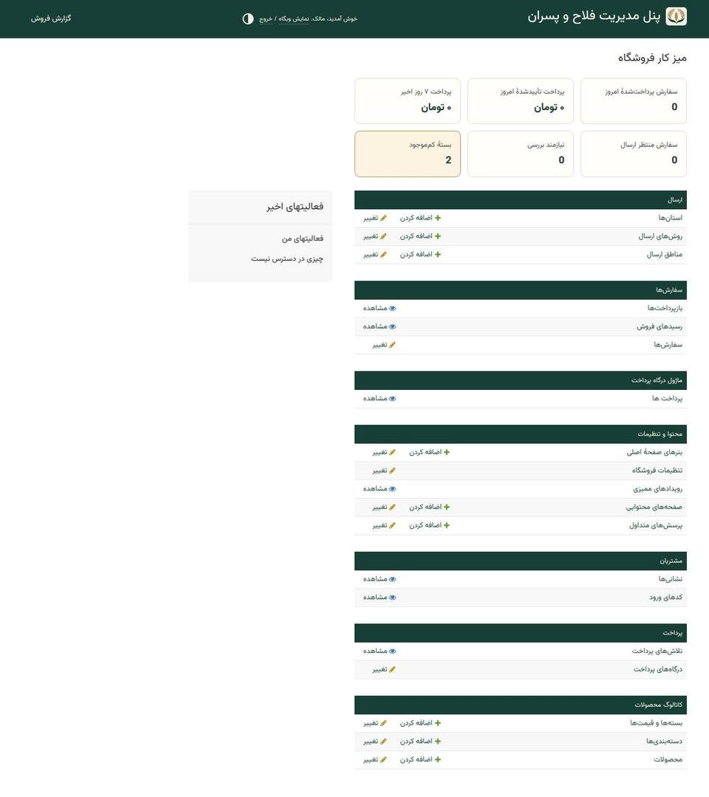

کارت‌های بالای صفحه: سفارش‌های پرداخت‌شدهٔ امروز، مبلغ تأییدشدهٔ امروز و ۷ روز اخیر (فقط برای
نقش مالک)، **سفارش‌های منتظر ارسال**، **نیازمند بررسی** (قرمز می‌شود) و **بستهٔ کم‌موجود**. روی هر
کارت بزنید تا فهرست همان موارد باز شود. هر روز اول کارت «نیازمند بررسی» را ببینید.

## ۳. محصولات

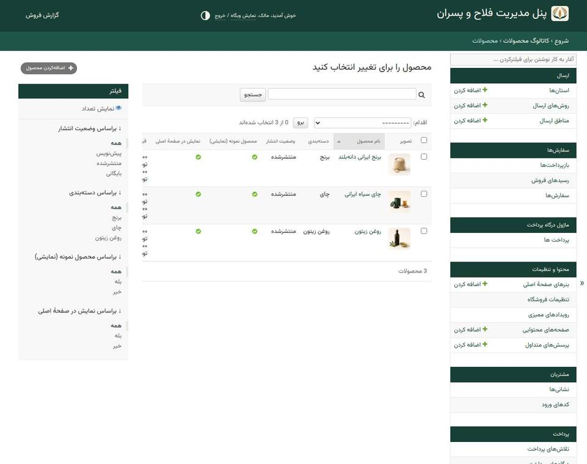

**کاتالوگ محصولات › محصولات › افزودن** یا روی نام محصول بزنید.

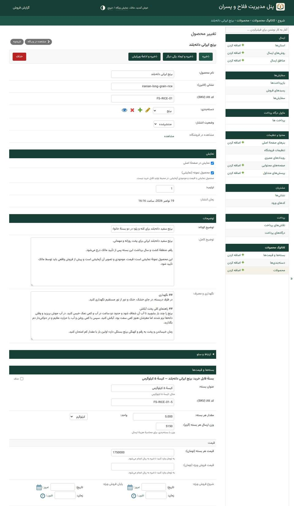

- **نام، نشانی (لاتین) و کد کالا:** نشانی با حروف لاتین و خط تیره، مثل `hashemi-rice-gilan`.
- **دسته‌بندی** و **وضعیت انتشار:** «پیش‌نویس» در سایت دیده نمی‌شود؛ «منتشرشده» دیده می‌شود؛
  «بایگانی» برای محصولی که دیگر نمی‌فروشید.
- **محصول نمونه (نمایشی):** فقط برای محصولات آزمایشی. محصول واقعی را هرگز نمونه علامت نزنید؛
  محصول نمونه در محیط واقعی قابل خرید نیست.
- **نمایش در صفحهٔ اصلی:** محصول در بخش «محصولات» صفحهٔ اول می‌آید.
- **توضیح کوتاه** زیر نام نمایش داده می‌شود. در **توضیح کامل** پاراگراف‌ها را با یک خط خالی جدا
  کنید و برای تیتر، خط را با `## ` شروع کنید.
- **نگهداری و مصرف:** روش نگهداری و پخت.
- فقط ادعایی بنویسید که درست و قابل اثبات است (مثلاً «ارگانیک» یا «درجهٔ یک» بدون مدرک ننویسید).

### بسته‌ها و قیمت‌ها

هر اندازهٔ بسته یک ردیف است:

| فیلد | توضیح |
|---|---|
| عنوان بسته | مثل «کیسهٔ ۱۰ کیلوگرمی» |
| کد کالا | یکتا، مثل `RICE-HASHEMI-10` |
| مقدار و واحد | ۱۰ و کیلوگرم؛ سایت قیمت هر کیلو را خودش حساب می‌کند |
| قیمت (تومان) | قیمت هر بسته. با جداکننده یا ارقام فارسی هم پذیرفته می‌شود |
| قیمت فروش ویژه + شروع/پایان | اختیاری؛ فقط در همان بازه اعمال می‌شود و درصد تخفیف خودکار نمایش داده می‌شود |
| موجودی قابل فروش | تعداد بستهٔ آماده. اگر هم‌زمان مشتری خرید کند، تغییر شما به‌صورت کم/زیاد اعمال می‌شود تا سفارش او از بین نرود |
| آستانهٔ هشدار | وقتی موجودی به این عدد برسد، در کارت «کم‌موجود» می‌آید |
| وزن ارسال (گرم) | وزن با بسته‌بندی؛ هزینهٔ پست با آن حساب می‌شود |
| فعال | بستهٔ غیرفعال در سایت دیده نمی‌شود |

فهرست همهٔ بسته‌ها با قیمت و موجودی در **بسته‌ها و قیمت‌ها** است:

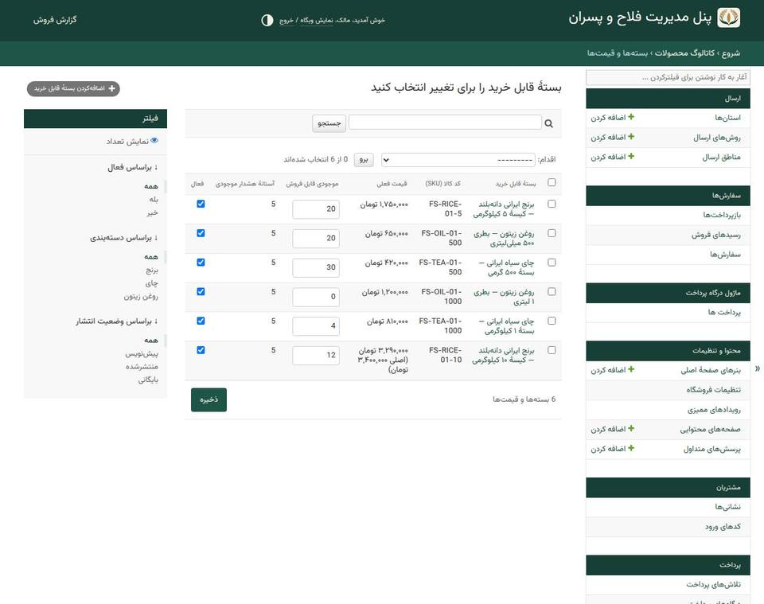

### تصویرها

در بخش **گالری تصاویر** محصول: JPEG، PNG، WebP یا AVIF تا ۸ مگابایت، ترجیحاً مربعی و حداقل
۱۲۰۰ پیکسل. برای هر تصویر **متن جایگزین** بنویسید (توصیف کوتاه تصویر برای نابینایان و گوگل).
اولین تصویر (کمترین «ترتیب») تصویر اصلی است. تصویرهای فعلی ساختگی‌اند؛ آن‌ها را با عکس واقعی
محصول خودتان جایگزین و ردیف قدیمی را حذف کنید.

**ویژگی‌ها** (مثل «نوع برنج: هاشمی»، «محصول سال: ۱۴۰۵») در جدول مشخصات صفحهٔ محصول نمایش
داده می‌شوند.

## ۴. سفارش‌ها

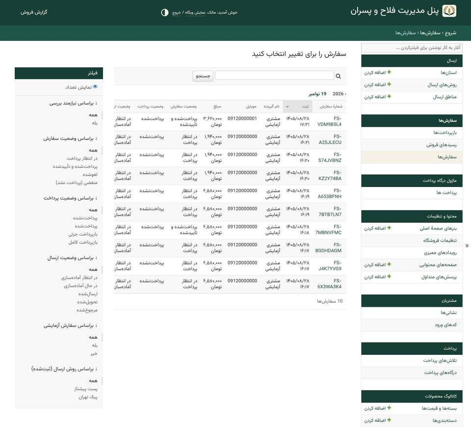

**سفارش‌ها › سفارش‌ها.** با فیلترهای کنار صفحه سفارش‌های پرداخت‌شده، منتظر ارسال یا نیازمند
بررسی را جدا کنید.

- سفارش «در انتظار پرداخت» هنوز پول نگرفته است؛ کالا تا ۳۰ دقیقه برای مشتری رزرو می‌ماند و
  بعد خودکار منقضی می‌شود.
- فقط سفارش **پرداخت‌شده و تأییدشده** را ارسال کنید.
- **هیچ دکمه‌ای برای «پرداخت‌شده» کردن دستی وجود ندارد.** پرداخت فقط با تأیید بانک ثبت
  می‌شود. اگر مشتری می‌گوید پول کسر شده ولی سفارش پرداخت‌نشده است، دکمهٔ **استعلام مجدد از
  درگاه** را بزنید؛ اگر بانک پرداخت را تأیید کند، سفارش خودکار تأیید می‌شود. در غیر این صورت
  معمولاً بانک مبلغ را ظرف ۷۲ ساعت برمی‌گرداند.

### صفحهٔ سفارش و عملیات

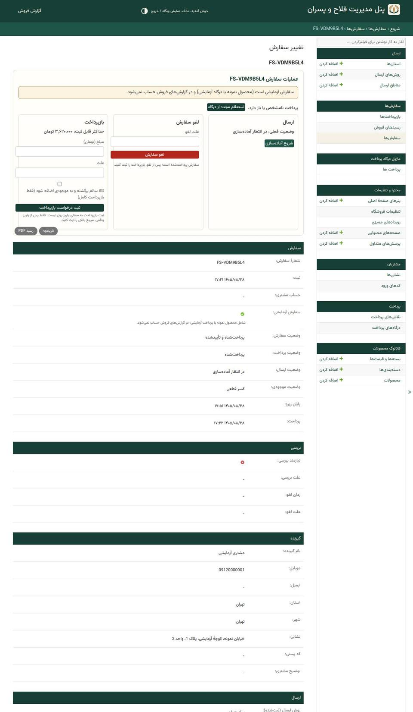

کادر **عملیات سفارش** بالای صفحه:

1. **ارسال:** «شروع آماده‌سازی» → پس از تحویل به شرکت حمل، نام شرکت، **کد رهگیری مرسوله** و
   در صورت وجود پیوند رهگیری را بنویسید و «ثبت ارسال» را بزنید → پس از تحویل «تحویل شد».
   مشتری هر مرحله را در صفحهٔ پیگیری می‌بیند. اگر کالا برگشت، «ثبت مرجوعی».
2. **لغو سفارش:** با نوشتن علت. سفارش ارسال‌شده لغو نمی‌شود (از مرجوعی و بازپرداخت استفاده
   کنید). لغو سفارش پرداخت‌شده خودکار آن را «نیازمند بررسی» می‌کند تا بازپرداخت فراموش نشود.
3. **بازپرداخت:** بخش ۶.
4. **رسید PDF:** رسید فروش فارسی با تاریخ شمسی برای چاپ یا ارسال به مشتری. (این رسید فاکتور
   رسمی مالیاتی نیست.)
5. **تاریخچه:** همهٔ رویدادهای سفارش و اینکه چه کسی چه کرد.

سفارش‌هایی که با محصول نمونه یا درگاه آزمایشی ثبت شده‌اند علامت «آزمایشی» دارند و در گزارش
فروش حساب نمی‌شوند.

### «نیازمند بررسی» یعنی چه؟

سیستم در این حالت‌ها سفارش را علامت می‌زند و تصمیم را به شما می‌سپارد:

- مبلغ یا مشخصات پرداخت با سفارش نمی‌خواند (مغایرت)؛
- مشتری دو بار برای یک سفارش پرداخت کرده است (مبلغ اضافه را بازپرداخت کنید)؛
- پرداخت پس از لغو یا پس از پایان رزرو رسیده و موجودی کافی نیست (کالا را تأمین یا بازپرداخت کنید)؛
- سفارش پرداخت‌شده لغو شده است.

پس از رسیدگی، «اقدام انجام‌شده» را بنویسید و **بستن مورد بررسی** را بزنید.

## ۵. ارسال

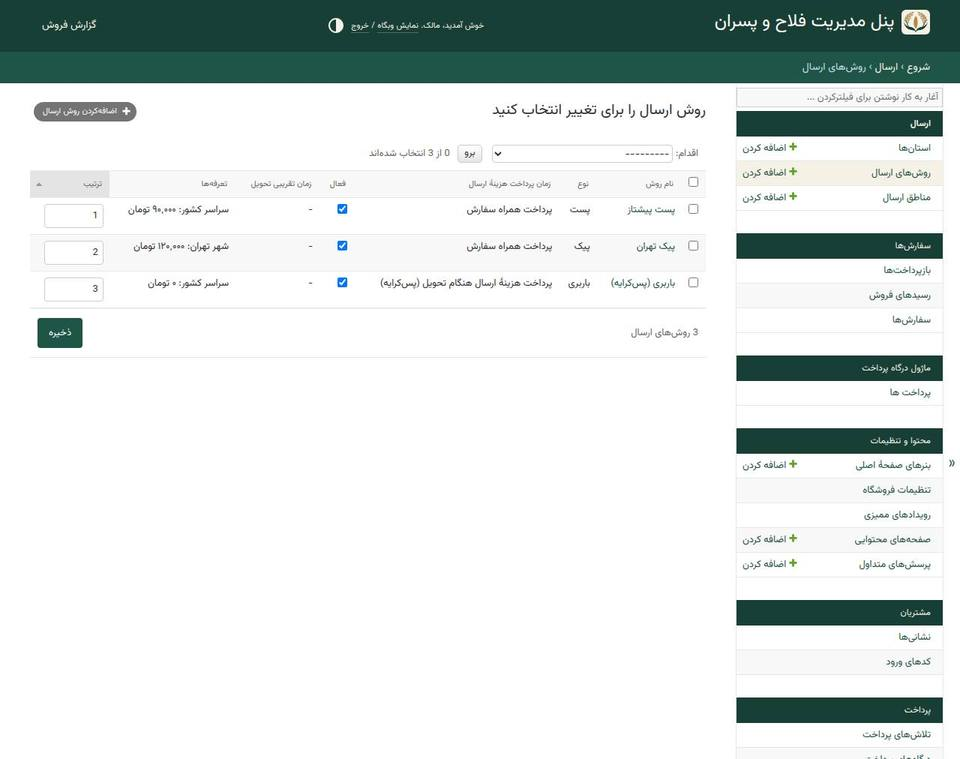

**ارسال › روش‌های ارسال.** سه روش آماده است و **همهٔ مبالغ آن‌ها فرضی است**؛ پیش از فروش
واقعی تعرفهٔ خودتان را وارد کنید:

| روش | منطقه | قاعدهٔ فعلی (نمونه) |
|---|---|---|
| پست پیشتاز | سراسر کشور | ۹۰٬۰۰۰ تومان تا ۲ کیلو، هر کیلوی اضافه ۲۵٬۰۰۰ تومان، رایگان از ۵٬۰۰۰٬۰۰۰ تومان؛ حداکثر ۳۰ کیلو |
| پیک تهران | فقط شهر تهران | ۱۲۰٬۰۰۰ تومان؛ حداکثر ۴۰ کیلو |
| باربری (پس‌کرایه) | سراسر کشور | از ۲۰ کیلو به بالا؛ کرایه را مشتری هنگام تحویل به باربری می‌دهد |

- در هر روش: نام، توضیح برای مشتری، **زمان تقریبی تحویل**، حداقل/حداکثر وزن و فعال بودن.
- در جدول **نرخ‌ها**: برای هر منطقه هزینهٔ پایه (تومان)، وزنی که هزینهٔ پایه شامل آن است، هزینهٔ
  هر کیلوی اضافه و آستانهٔ ارسال رایگان.
- **مناطق ارسال** مجموعه‌ای از استان‌ها و در صورت نیاز نام شهرهاست (مثلاً «شهر تهران»):

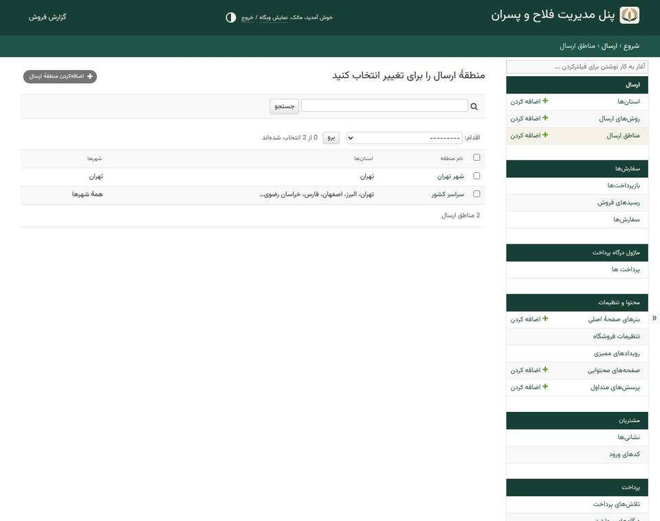

مشتری فقط روش‌هایی را می‌بیند که به استان و شهرش می‌رسد و وزن سفارش در محدودهٔ آن است.

## ۶. بازپرداخت

بازپرداخت در این سایت **پول را خودکار برنمی‌گرداند**؛ فقط آن را ثبت و پیگیری می‌کند:

1. در صفحهٔ سفارش، بخش **بازپرداخت**: مبلغ (تومان، حداکثر مبلغ قابل بازپرداخت نمایش داده
   می‌شود) و علت را بنویسید. اگر کالا سالم برگشته و کل مبلغ را برمی‌گردانید، گزینهٔ بازگشت کالا به
   موجودی را بزنید. «ثبت درخواست بازپرداخت».
2. **تأیید** یا **رد**.
3. پول را از پنل درگاه پرداخت یا با واریز بانکی واقعاً برگردانید.
4. **مرجع بانکی واریز** را بنویسید و «ثبت واریز» را بزنید. فقط در این مرحله وضعیت پرداخت سفارش
   «بازپرداخت جزئی» یا «بازپرداخت کامل» می‌شود و در گزارش کم می‌شود.

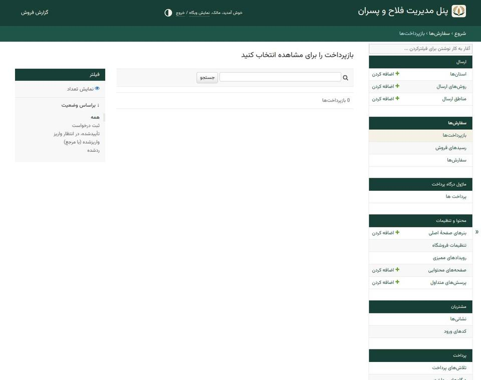

## ۷. گزارش‌ها

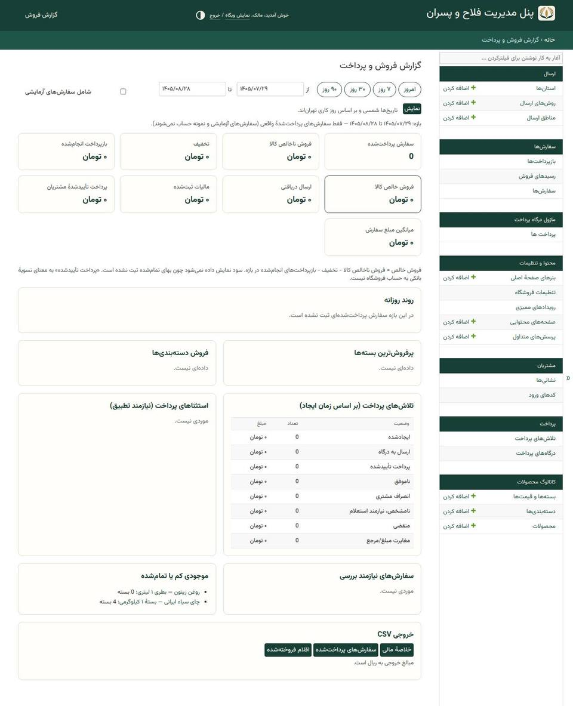

**گزارش فروش** (بالای پنل، فقط نقش مالک). بازهٔ امروز، ۷، ۳۰ یا ۹۰ روز یا تاریخ دلخواه شمسی:

- **خلاصهٔ مالی:** تعداد سفارش پرداخت‌شده، فروش ناخالص کالا، تخفیف، بازپرداخت انجام‌شده، فروش
  خالص کالا، ارسال دریافتی، مالیات و پرداخت تأییدشدهٔ مشتریان.
- روند روزانه/ماهانه، پرفروش‌ترین بسته‌ها، فروش هر دسته، تلاش‌های پرداخت به تفکیک درگاه و
  وضعیت، استثناهای پرداخت، سفارش‌های نیازمند بررسی و وضعیت موجودی.
- **خروجی CSV** برای سفارش‌ها، اقلام فروخته‌شده و خلاصه (مبالغ CSV به ریال است؛ در اکسل باز
  می‌شود).
- سود نمایش داده نمی‌شود، چون بهای خرید کالا در سیستم ثبت نمی‌شود. «پرداخت تأییدشده» به معنای
  واریز بانک به حساب شما نیست؛ تسویه را در پنل درگاه ببینید.

## ۸. تنظیمات فروشگاه و محتوا

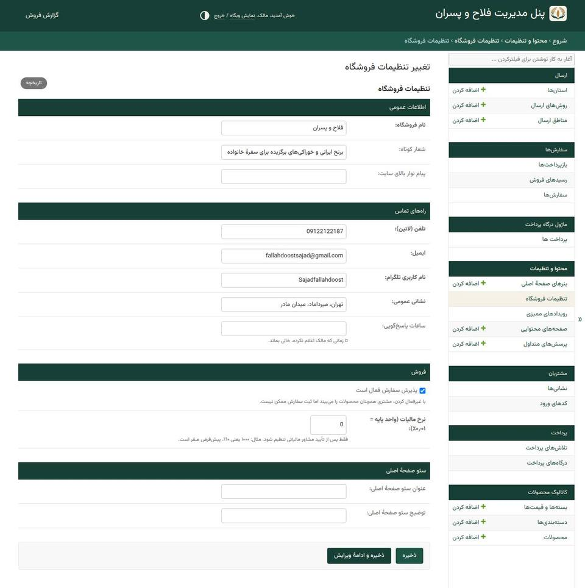

**محتوا و تنظیمات › تنظیمات فروشگاه:**

- نام، شعار، تلفن، ایمیل، تلگرام، نشانی؛ **ساعت کاری** را فقط اگر قطعی است بنویسید (خالی باشد
  نمایش داده نمی‌شود).
- **پیام نوار بالای سایت** برای اطلاعیهٔ کوتاه.
- **فروش فعال:** اگر خاموش شود، سایت باز است ولی ثبت سفارش متوقف می‌شود (برای تعطیلات یا
  انبارگردانی).
- نرخ مالیات (پیش‌فرض صفر).

**بنرهای صفحهٔ اصلی**، **صفحه‌های محتوایی** (درباره، حریم خصوصی، مرجوعی، ارسال، قوانین) و
**پرسش‌های متداول** هم همین‌جا ویرایش می‌شوند. متن صفحه‌های قوانین فعلاً **پیش‌نویس** است و
بالای آن‌ها در سایت نوشته شده «این متن پیش‌نویس است و پس از تأیید مالک فروشگاه نهایی می‌شود»؛ پس از بازبینی (ترجیحاً با مشاور حقوقی)، گزینهٔ
«نیازمند تأیید مالک» را بردارید.

تغییرات کاتالوگ و محتوا چند ثانیه بعد در سایت دیده می‌شود.

## ۹. درگاه‌های پرداخت

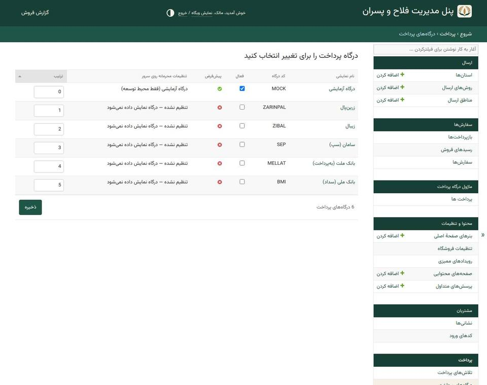

درگاهی به مشتری نشان داده می‌شود که هم **اطلاعات قرارداد آن روی سرور ثبت شده باشد** (توسط
پشتیبان فنی، هرگز در پنل یا پیام‌رسان) و هم اینجا **فعال** باشد. «درگاه آزمایشی» فقط در نسخهٔ
توسعه کار می‌کند و در نسخهٔ واقعی خودکار غیرفعال است.

این سایت **هرگز** شمارهٔ کارت، رمز دوم یا CVV2 نمی‌گیرد؛ این اطلاعات فقط در صفحهٔ بانک وارد
می‌شود. اگر کسی به نام فروشگاه این اطلاعات را خواست، کلاهبرداری است.

## ۱۰. پیش از راه‌اندازی

- [ ] محصولات واقعی با قیمت، موجودی، وزن و عکس واقعی؛ حذف یا بایگانی سه محصول نمونه و بنر نمونه
- [ ] قرارداد درگاه پرداخت و یک پرداخت واقعی کوچک + یک بازپرداخت آزمایشی با رضایت شما
- [ ] سامانهٔ پیامک (کاوه‌نگار) و الگوی پیامک کد ورود
- [ ] تعرفه‌ها و زمان تحویل واقعی ارسال
- [ ] بازبینی و تأیید متن قوانین، حریم خصوصی، مرجوعی و ارسال
- [ ] دامنه، میزبان، HTTPS و پشتیبان‌گیری روزانه
- [ ] نماد اعتماد الکترونیکی (اینماد) در صورت نیاز درگاه؛ تا دریافت نشده، هیچ نمادی نمایش داده نمی‌شود
- [ ] بررسی تشابه نام با فروشگاه‌های دیگر (مثلاً fallah.shop)

