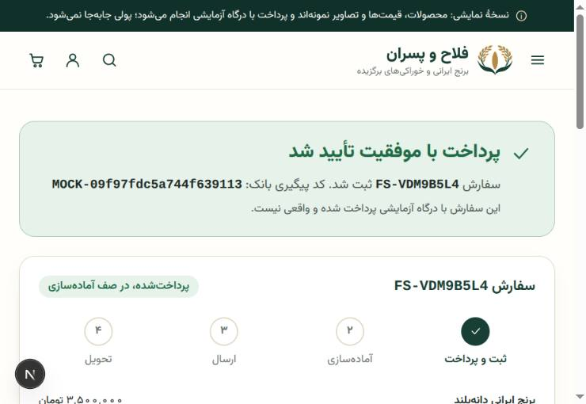
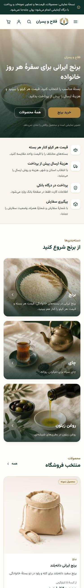
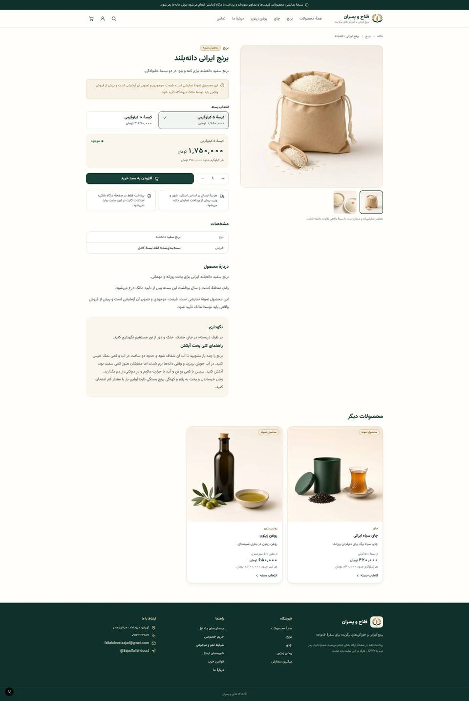
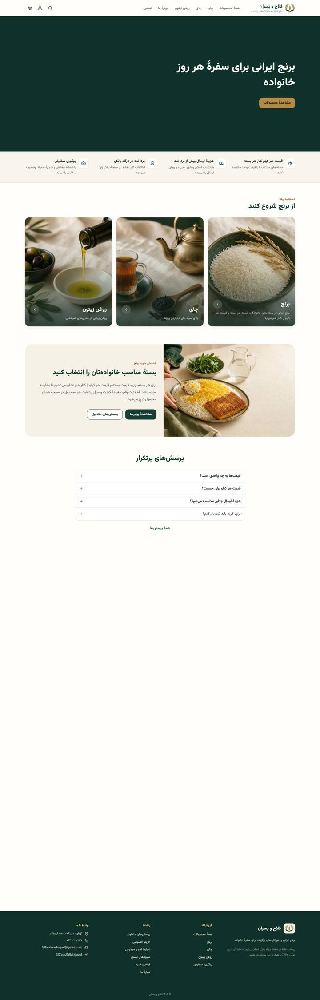

# Testing

Results from 2026-11-19 on Linux, Python 3.12.3, Node 20.20, PostgreSQL 17, Chrome (headless).

## Automated checks

| Check | Command | Result |
|---|---|---|
| Backend lint | `ruff check .` | pass |
| Backend format | `ruff format --check .` | pass (83 files) |
| Migration drift | `manage.py makemigrations --check --dry-run` | no changes |
| Backend tests | `pytest` (PostgreSQL) | **86 passed** |
| Frontend types | `npx next typegen && npm run typecheck` | pass |
| Frontend lint | `npm run lint` | pass |
| Frontend build | `npm run build` | pass; 23 routes, pages are partial prerenders |
| Docker images | `docker compose build` | backend and frontend built |

CI (`.github/workflows/ci.yml`) runs the same checks plus image builds on every push and PR.

### What the backend tests cover (`backend/tests/`)

| File | Tests | Covers |
|---|---|---|
| `test_checkout.py` | 18 | CSRF on unsafe requests, server-side prices, expected-total mismatch, price change notice, stock reservation and cart clearing, stock limits, invalid quantities, stock drop before checkout, idempotent checkout bound to the session, sales switch, sample products, address/phone validation, shipping eligibility |
| `test_payments.py` | 15 | Confirm once, order token never sent to the gateway, failed payment keeps order payable, tampered return query, repeated callback, amount mismatch, timeout + reconciliation, expiry + late payment, late payment without stock, duplicate payment, no second payment after paid, mock gateway disabled/foreign callback, unknown provider, Zarinpal integer toman |
| `test_money_text.py` | 16 | Rial/toman, whole-toman validator, phone normalization, Persian/Arabic digits and letters, Jalali dates and Tehran day bounds, CSV formula injection |
| `test_accounts_authz.py` | 10 | OTP hashing, single use, attempt limit, cooldown, guest cart merge, staff cannot use OTP, order access by owner/token, tracking privacy, account isolation, role permissions, no "mark paid" path in admin, customers cannot reach admin |
| `test_lifecycle_reports.py` | 8 | Fulfillment flow and invalid jumps, unpaid cannot ship, partial/full refunds with restock, report totals vs orders excluding test orders, CSV (UTF-8 BOM) matches, seed idempotent and preserves owner edits, seed refuses samples in production |
| `test_catalog_pricing.py` | 6 | Unit price per kg/litre, sale window, drafts hidden, filters/sort, shipping weight tiers and free threshold, category order |
| `test_settings_guards.py` | 5 | Safe production defaults; refuses DEBUG, missing secret, mock gateway, console SMS |
| `test_admin_pages.py` | 4 | Every registered admin page renders; money cards only for report viewers; reports forbidden without permission; review filter |
| `test_inventory_concurrency.py` | 3 | Last unit sold once under concurrency, parallel multi-item orders never oversell, cancellation releases once |

## Manual end-to-end purchase (development, mock gateway)

Done in a browser against the dev servers:

1. Product page → choose 5 kg → add 2 to cart → cart → checkout (Tehran, Tehran city).
2. Shipping options quoted by weight: post 315,000 toman for about 10.3 kg; Tehran courier
   120,000 toman; freight unavailable under 20 kg.
3. Placed order **FS-VDM9B5L4**: 2 × 1,750,000 + 120,000 = 3,620,000 toman.
4. Mock gateway page showed the amount and reference; "simulate success" → returned to the result
   page: "پرداخت با موفقیت تأیید شد", bank reference, order stage "paid, queued for preparation".
5. Receipt PDF downloaded (200, `application/pdf`); without the order token: 404.
6. Tracking by order number (typed lowercase) + phone showed the order and its events.
7. SMS login (code from the dev console, typed with Persian digits) → account page.
   The guest order is not attached to the account by design (a phone number alone must not expose
   orders).

Two bugs were found and fixed during this run: the GET gateway redirect dropped its parameters,
and the result page kept polling instead of offering a retry for an abandoned attempt.

## Responsive and accessibility audit

Headless Chrome over CDP, 14 pages × 6 widths (320, 375, 768, 1024, 1440, 1920 px): home, shop,
category, two product pages, cart, checkout, track, account, about, contact, FAQ, a content page,
404. Checks per page: no horizontal overflow, no console errors, every image has `alt`, exactly one
`h1`. **Final run: 0 problems.**

Fixed along the way: 16 px overflow at 320 px (header), an empty fourth grid column with three
products, missing `h1` on the 404 page, small tap targets in footer and breadcrumbs, a client
hook outside Suspense that broke the build, the image optimizer failing on uploaded media.

Other properties: `lang="fa" dir="rtl"`, skip link, visible focus ring, keyboard-usable menu
(Escape closes), `aria-live` cart announcements, reduced-motion support, form errors linked to
fields with an error summary.

| Mobile home (375) | Desktop product (1920) |
|---|---|
|  |  |

More screenshots: [`docs/images/`](images/) (storefront `store-*`, admin `admin-*`).

## Admin

All admin pages render (automated test). The admin was checked in light and dark mode; the custom
order-operations panel and dashboard cards were unreadable in dark mode and were fixed to follow
the theme.

## Production-style stack

`docker compose up` with production settings (`STORE_ENV=production`) on a local port:

- All services healthy; migrations and cache table created on start; scheduler ran
  `maintain_orders`.
- Through nginx: `/`, `/shop`, `/api/health/`, `/api/v1/site/`, `/admin/login/`, static fonts,
  `robots.txt`, `sitemap.xml` → 200; `/api/revalidate` → 404 from outside; `/payments/mock-gateway/`
  → 404; optimized uploaded media (`/_next/image?url=/media/…`) → 200 AVIF; `/media/../etc/passwd`
  → 404. Security headers present.
- The production guards refused to start with `PAYMENT_MOCK_ENABLED=true`, `SMS_BACKEND=console`
  or `DJANGO_DEBUG=true`; `seed_store` refused samples; `seed_store --no-samples` worked and the
  home page showed no products, no demo banner.

## Not tested

- Any real or sandbox payment provider (no credentials). See [PAYMENTS.md](PAYMENTS.md#going-live).
- Real SMS delivery (Kavenegar code path written, not exercised without an API key).
- Real HTTPS, domain and hosting; load testing; backup restore on a real server.
- Screen-reader testing with NVDA/VoiceOver (structure checked automatically only).
- Safari/iOS and Firefox (Chrome only).

## Launch blockers

1. **Real catalog:** products, package sizes, prices, stock, real photos; remove or unpublish the
   three sample products (they are marked as samples and cannot be bought in production).
2. **Payment:** a merchant contract and credentials for at least one provider, callback URL
   registered, one owner-approved live payment and refund.
3. **SMS provider:** Kavenegar API key and an approved OTP template (or switch providers).
4. **Shipping tariffs:** the seeded post/courier/freight rates are placeholders; set real prices,
   zones and delivery estimates.
5. **Policies:** privacy, returns, shipping, terms and about pages are drafts marked "needs owner
   review"; the owner (ideally with legal advice) must approve them.
6. **Hosting and domain:** server, domain, HTTPS, backups. Consider eNamad and Shaparak
   requirements for Iranian gateways; no trust seals are shown until they really exist.
7. **Name overlap:** fallah.shop already trades as «برنج فلاح و پسران»; check trademark and
   possible confusion before launch (see [REFERENCE_RESEARCH.md](REFERENCE_RESEARCH.md)).
